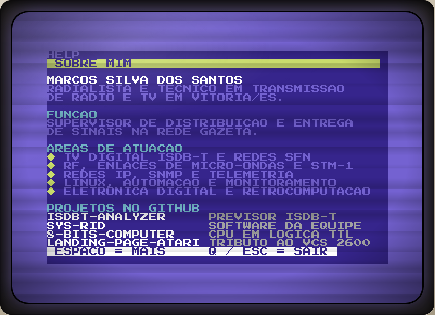
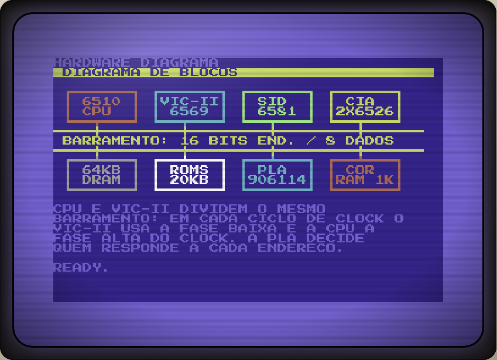
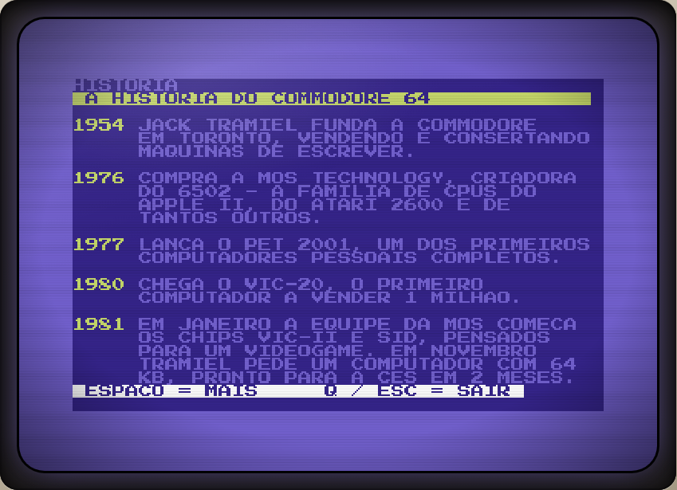
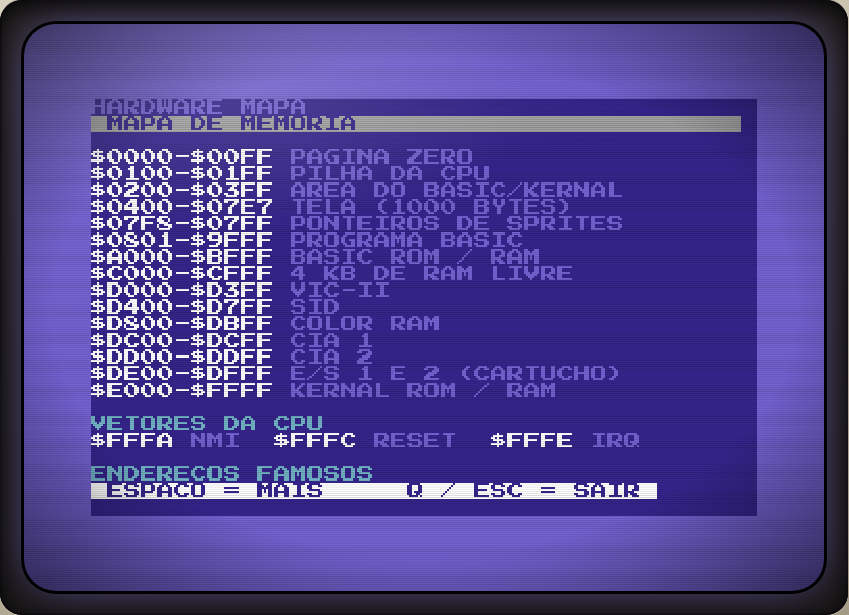
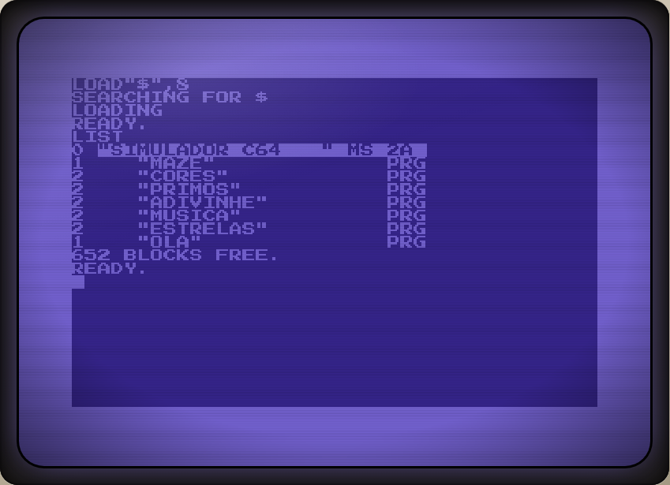
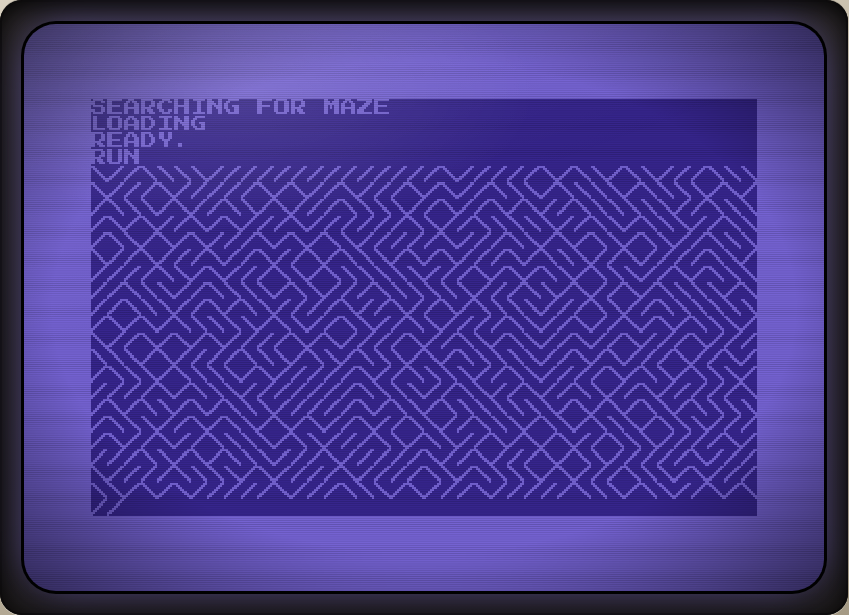
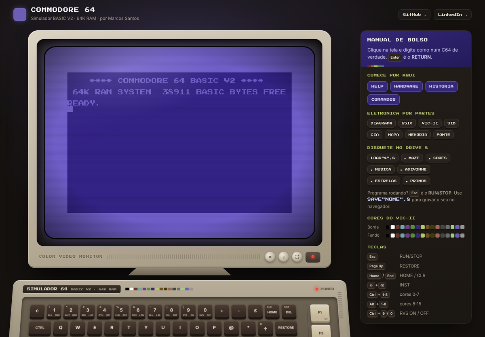
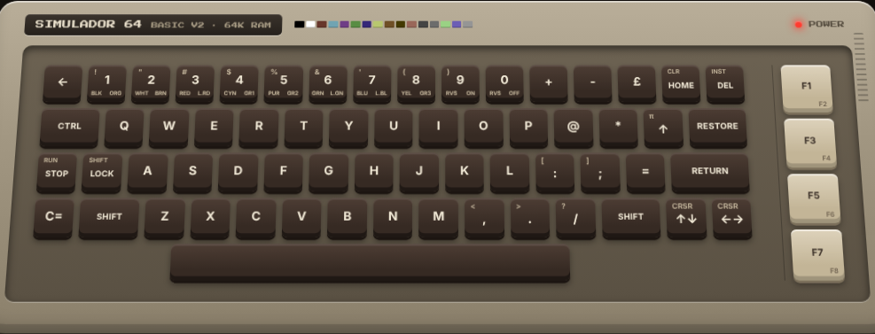
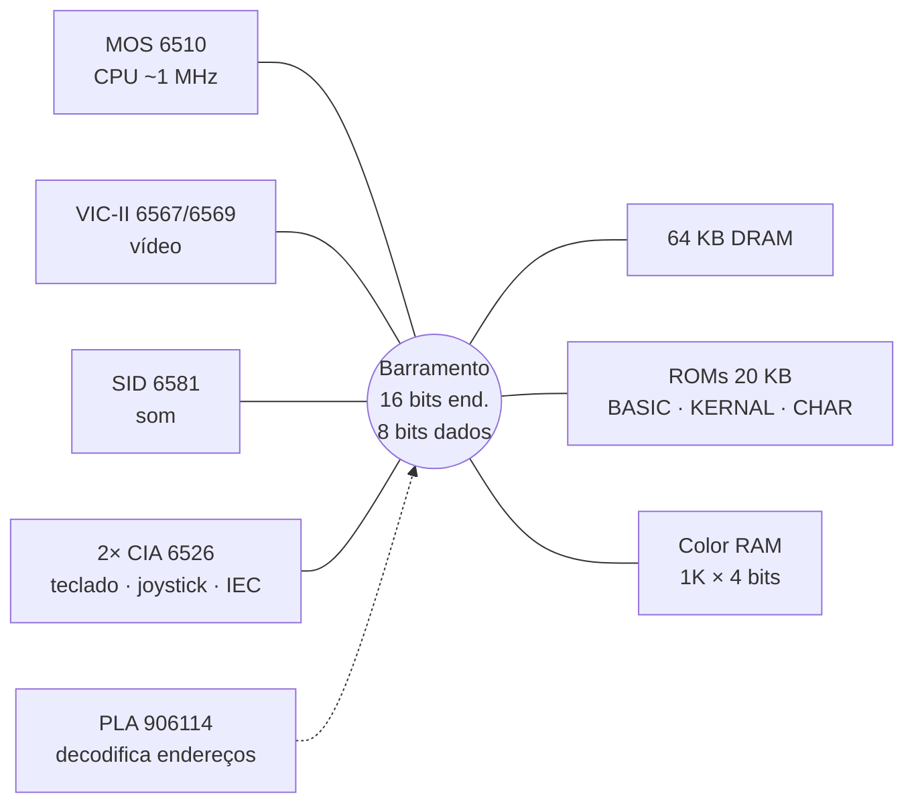

<div align="center">


# Commodore 64 · Simulador BASIC V2

**Ligue um Commodore 64 no navegador.**<br>
Tela do VIC-II desenhada pixel a pixel, BASIC V2 de verdade, som do SID, disquete virtual<br>
e um tour pela eletrônica e pela história da máquina   tudo dentro do próprio terminal.

[**▶ Abrir o simulador**](https://aragonxpd154.github.io/landing-page-commodore-64/) &nbsp;·&nbsp;
[Comandos](#-comandos) &nbsp;·&nbsp;
[Hardware](#-o-hardware-do-commodore-64) &nbsp;·&nbsp;
[História](#-história)

<br>


</div>

---

```
    **** COMMODORE 64 BASIC V2 ****

 64K RAM SYSTEM  38911 BASIC BYTES FREE

READY.
█
```

## ✦ Sobre o projeto

Este repositório começou como uma landing page com a tela azul do C64. Agora ele é um **simulador funcional**: você liga a máquina, vê o boot original, digita em um editor de tela igual ao do C64 e roda programas em BASIC   com `POKE`, `PEEK`, cores, som e disquete.

Como no meu projeto do [Atari VCS 2600](https://github.com/aragonxpd154/landing-page-atari-vcs-2600), o terminal também conta quem fez o projeto (`HELP` / `SOBRE`) e abre a máquina por dentro (`HARDWARE`), agora com uma seção de **história** (`HISTORIA`).

Tudo é feito em **HTML, CSS e JavaScript puros**: sem frameworks, sem build e sem dependências. Basta abrir o `index.html`.

## ✦ Destaques

| | |
|---|---|
| 🖥️ **Tela do VIC-II real** | 40×25 caracteres em um canvas de 384×272 (320×200 + borda), paleta de 16 cores, memória de tela em `1024` e Color RAM em `55296`   dá para escrever direto com `POKE`. |
| 🔤 **Conjunto de caracteres PETSCII** | Letras em ROM de caracteres própria (`js/chargen.js`) e gráficos PETSCII   linhas, blocos, naipes, diagonais   desenhados pixel a pixel. |
| ⌨️ **Editor de tela do C64** | Cursor piscando, linhas lógicas de 80 colunas, `INST/DEL`, *quote mode*, cores com `CTRL`/`C=` e reverso (`RVS ON/OFF`). |
| 🧠 **BASIC V2** | Palavras-chave sem espaço (`FORI=1TO10`), variáveis com 2 letras significativas, `-1` como verdadeiro e as mensagens de erro originais (`?SYNTAX  ERROR IN 10`). |
| 🔊 **SID de 3 vozes** | Triângulo, dente-de-serra, pulso e ruído com envelope ADSR via Web Audio, controlado pelos registradores `54272–54296`. |
| 💾 **Drive 1541 virtual** | `LOAD"$",8` mostra o diretório, `LOAD`/`SAVE`/`VERIFY` funcionam e os seus programas ficam salvos no navegador. |
| 📖 **Terminal-manual** | `HELP`, `HARDWARE` (13 seções) e `HISTORIA`, com paginação estilo `more`. |
| 🎛️ **Monitor e teclado** | Monitor CRT com *scanlines*, vinheta, brilho que acompanha a cor da borda e animação de liga/desliga; teclado completo clicável. |
| 📱 **Responsivo** | Funciona no celular: teclado virtual ou o teclado nativo do aparelho (toque na tela). |

## ✦ Capturas

<table>
  <tr>
    <td width="50%"><br><sub><b>HELP / SOBRE</b>   quem fez o projeto</sub></td>
    <td width="50%"><br><sub><b>HARDWARE DIAGRAMA</b>   os chips no barramento</sub></td>
  </tr>
  <tr>
    <td><br><sub><b>HISTORIA</b>   de 1954 a 1994</sub></td>
    <td><br><sub><b>HARDWARE MAPA</b>   mapa de memória</sub></td>
  </tr>
  <tr>
    <td><br><sub><b>LOAD"$",8</b> + <b>LIST</b>   diretório do disquete</sub></td>
    <td><br><sub><b>MAZE</b>   o clássico <code>10 PRINT</code></sub></td>
  </tr>
</table>

<p align="center">
  
</p>

## ✦ Comandos

Clique na tela, digite o comando e tecle **RETURN** (`Enter`).

| Comando | O que faz |
|---|---|
| `HELP` ou `SOBRE` | Mostra quem fez o projeto e a lista de comandos |
| `HARDWARE` | Tour completo pela eletrônica do C64 (paginado) |
| `HARDWARE <SEÇÃO>` | Só uma seção: `VISAO` `DIAGRAMA` `CPU` `VIC` `SID` `CIA` `MEMORIA` `MAPA` `PLA` `CLOCK` `ENERGIA` `PORTAS` `PLACA` |
| `HISTORIA` | Linha do tempo do Commodore 64 |
| `COMANDOS` | Lista rápida de comandos |
| `LOAD"$",8` → `LIST` | Diretório do disquete |
| `LOAD"MAZE",8` → `RUN` | Carrega e roda um programa |
| `SAVE"NOME",8` | Grava o seu programa (fica no `localStorage`) |
| `DIR` | Atalho para listar o disquete |
| `GITHUB` / `LINKEDIN` | Abre meus perfis |
| `TURBO` | Liga/desliga a velocidade 25× |
| `SYS 64738` | Reset, como no C64 |
| `CLS` | Limpa a tela |

Durante a paginação: **ESPAÇO** avança, **Q** ou **Esc** sai (no celular, toque na tela).

## ✦ BASIC V2 suportado

| Tipo | Palavras-chave |
|---|---|
| **Comandos** | `PRINT` `?` `LET` `IF…THEN/GOTO` `FOR…TO…STEP` `NEXT` `GOTO` `GOSUB` `RETURN` `ON…GOTO/GOSUB` `END` `STOP` `CONT` `REM` `DIM` `DATA` `READ` `RESTORE` `INPUT` `GET` `DEF FN` `POKE` `SYS` `WAIT` `CLR` `NEW` `RUN` `LIST` `LOAD` `SAVE` `VERIFY` |
| **Funções** | `ABS` `INT` `SGN` `SQR` `RND` `SIN` `COS` `TAN` `ATN` `EXP` `LOG` `PEEK` `FRE` `POS` `TAB(` `SPC(` `FN` |
| **Strings** | `LEN` `LEFT$` `MID$` `RIGHT$` `CHR$` `ASC` `STR$` `VAL` |
| **Operadores** | `+ - * / ↑` `= <> < > <= >=` `AND` `OR` `NOT` |
| **Variáveis** | `A` `A%` `A$` `A(10)` `TI` `TI$` `ST` |

**Endereços que funcionam com `POKE`/`PEEK`:**

| Endereço | Função |
|---|---|
| `53280` / `53281` | Cor da borda / do fundo (0–15) |
| `646` | Cor do texto |
| `1024–2023` | Memória de tela |
| `55296–56295` | Color RAM |
| `53265` | `POKE 53265,11` apaga a tela · `POKE 53265,27` acende |
| `53266` | Linha de *raster* atual |
| `54272–54296` | Registradores do SID (som) |
| `198` | Teclas no buffer do teclado |

Experimente:

```basic
10 PRINT CHR$(205.5+RND(1));:GOTO 10
```

```basic
POKE 53280,0:POKE 53281,0:POKE 646,5:PRINT CHR$(147);"OLA, C64!"
```

## ✦ Teclado

| No seu teclado | No C64 |
|---|---|
| `Enter` / `Shift`+`Enter` | RETURN / SHIFT+RETURN |
| `Backspace` / `Shift`+`Backspace` | DEL / INST |
| `Esc` | RUN/STOP |
| `Page Up` | RUN/STOP + RESTORE |
| `Home` / `End` | HOME / CLR |
| Setas | CRSR ↑ ↓ ← → |
| `Ctrl`+`1`…`8` | Cores 0–7 (BLK, WHT, RED, CYN, PUR, GRN, BLU, YEL) |
| `Alt`+`1`…`8` | Cores 8–15 (C= + número) |
| `Ctrl`+`9` / `Ctrl`+`0` | RVS ON / RVS OFF |

O teclado virtual da página também aceita `SHIFT`, `CTRL`, `C=` e `SHIFT LOCK` (clique no modificador e depois na tecla). `SHIFT` + letra gera os gráficos PETSCII.

<p align="center"></p>

## ✦ Programas no disquete

| Arquivo | O que faz |
|---|---|
| `MAZE` | O labirinto infinito de uma linha (`10 PRINT`) |
| `CORES` | As 16 cores do VIC-II e a borda piscando |
| `MUSICA` | Escala de dó maior tocada no SID |
| `ADIVINHE` | Jogo de adivinhar o número (usa `INPUT`) |
| `ESTRELAS` | Céu estrelado com `POKE` na tela e na Color RAM |
| `PRIMOS` | Números primos até 300, cronometrados com `TI` |
| `OLA` | "Olá, mundo" em todas as cores |

## ✦ O hardware do Commodore 64



| Bloco | Chip | Destaques |
|---|---|---|
| **CPU** | MOS 6510 | Núcleo 6502 de 8 bits, 0,985 MHz (PAL) / 1,023 MHz (NTSC), porta de E/S em `$0000/$0001` para *bank switching* e datasette |
| **Vídeo** | VIC-II 6567 / 6569 | 320×200, 16 cores, 8 sprites de 24×21, interrupção de *raster*, rolagem fina; gera o refresh da DRAM |
| **Som** | SID 6581 | 3 vozes, 4 formas de onda, ADSR, filtro analógico multimodo, *ring mod* e *sync* |
| **E/S** | 2× CIA 6526 | Teclado e joysticks (CIA 1), barramento serial IEC e banco do VIC (CIA 2), timers e relógio TOD |
| **RAM** | 4164 / 41464 | 64 KB dinâmica + 1 KB×4 de Color RAM (2114) |
| **ROM** | 901226 / 901227 / 901225 | BASIC 8 KB, KERNAL 8 KB, caracteres 4 KB |
| **Lógica** | PLA 906114 | Gera os *chip selects*; TTL 74LS257/139/373, 4066 e 7406 de apoio |
| **Energia** | Fonte externa | +5 V DC e 9 V AC; 7812 interno gera 12 V para VIC-II e SID |

No simulador, `HARDWARE` detalha cada um desses blocos, o mapa de memória completo, o clock (cristais e divisores), os conectores e as revisões de placa.

## ✦ História

| Ano | Marco |
|---|---|
| **1954** | Jack Tramiel funda a Commodore em Toronto, com máquinas de escrever |
| **1976** | A Commodore compra a MOS Technology, criadora do 6502 |
| **1977** | Lançamento do PET 2001 |
| **1980** | VIC-20, o primeiro computador a vender 1 milhão de unidades |
| **1981** | A MOS projeta o VIC-II e o SID; Tramiel pede um computador de 64 KB em dois meses |
| **1982** | Estreia na CES (janeiro) e chega às lojas em agosto por US$ 595 |
| **1983** | Guerra de preços: o C64 cai para cerca de US$ 200 |
| **1984** | Tramiel sai e compra a divisão de consumo da Atari; sai o SX-64 portátil |
| **1985** | Commodore 128 e Amiga 1000 |
| **1986** | C64C, com gabinete novo, chips HMOS e a interface gráfica GEOS |
| **1994** | Falência da Commodore e fim da produção |

Com estimativas entre **12,5 e 17 milhões** de unidades, é o modelo de computador mais vendido da história   e o berço da demoscene e da música SID.

## ✦ Por dentro do simulador

```
landing-page-commodore-64/
├── index.html          # página: monitor, gabinete, teclado e manual de bolso
├── favicon.svg
├── css/
│   └── style.css       # monitor CRT, gabinete, teclado e layout responsivo
├── js/
│   ├── chargen.js      # ROM de caracteres (screen codes 0–63, 8 bytes cada)
│   ├── screen.js       # VIC-II: memória de tela, Color RAM, PETSCII, editor e render
│   ├── sid.js          # SID de 3 vozes com Web Audio
│   ├── basic.js        # tokenizador e interpretador BASIC V2
│   ├── content.js      # textos de HELP, HARDWARE, HISTORIA e programas do disquete
│   └── main.js         # "placa-mãe": memória, teclado, disquete, paginador e UI
├── fonts/
│   ├── PressStart2P.woff2
│   └── OFL.txt
└── docs/               # imagens deste README
```

Cada quadro (60 Hz) o laço principal avança o BASIC com um "orçamento" de comandos que imita a velocidade de um 6510 a ~1 MHz, atualiza o cursor (pisca a cada 20 *jiffies*, como o KERNAL) e redesenha o canvas só quando algo mudou.

## ✦ Como rodar

Não há instalação. Escolha uma opção:

```bash
# 1) abrir direto
#    dê dois cliques em index.html

# 2) ou servir localmente
python3 -m http.server 8000
# e abrir http://localhost:8000
```

### Publicar no GitHub Pages

1. No repositório, abra **Settings → Pages**.
2. Em **Source**, escolha **Deploy from a branch**.
3. Selecione a branch `main` e a pasta `/ (root)` e salve.
4. Em alguns minutos o site fica em `https://aragonxpd154.github.io/landing-page-commodore-64/`.

## ✦ Personalizar

- **Seus dados** (`HELP`/`SOBRE`): edite o objeto `PERFIL` no início de `js/content.js`.
- **Textos do hardware e da história**: funções `HW.*` e `pageHistoria()` no mesmo arquivo. Use as marcações de cor `{wht}` `{yel}` `{cyn}` `{lbl}`… e mantenha cada linha com até 39 caracteres.
- **Novos programas no disquete**: adicione uma entrada em `DEMOS`, com as linhas numeradas como no C64.

## ✦ Créditos e licença

- Código sob a licença [MIT](LICENSE).
- Fonte **Press Start 2P** © 2012 The Press Start 2P Project Authors, sob a [SIL Open Font License 1.1](fonts/OFL.txt); a ROM de caracteres em `js/chargen.js` deriva dela.
- Commodore 64 é marca de seus respectivos proprietários. Este é um projeto de fã, sem afiliação, sem ROMs originais e sem código da Commodore.

---

<div align="center">

Feito por **Marcos Santos**   radialista e técnico em transmissão de rádio e TV.

[GitHub](https://github.com/aragonxpd154) · [LinkedIn](https://www.linkedin.com/in/marcosobel)

<sub>READY.</sub>

</div>
